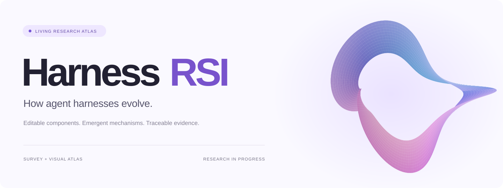
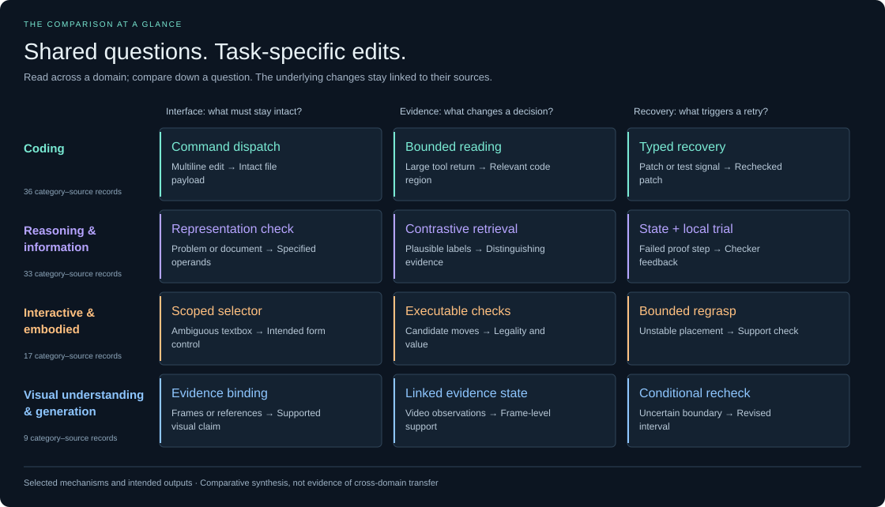
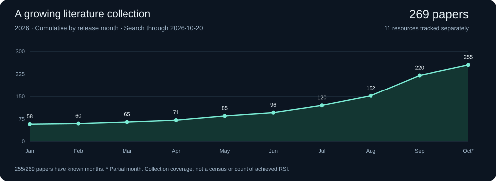

<p align="center"><strong>What actually evolves around the model?</strong><br>A curated, source-traceable evidence dataset and research atlas of reported agent-harness changes.<br><sub>Survey companion · Versioned data · Reported gains, failures and evidence limits</sub></p>

<p align="center"><a href="https://lucasxinyu.github.io/harness-rsi/"><strong>Explore the interactive website ↗</strong></a> · <a href="https://lucasxinyu.github.io/harness-rsi/#benchmarks">Benchmark evidence</a> · <a href="https://lucasxinyu.github.io/harness-rsi/#activity">Literature growth</a></p>

<p align="center"><a href="#what-we-study">Our work</a> · <a href="#compare-the-mechanisms">Compare mechanisms</a> · <a href="#evidence-you-can-trace">Evidence</a> · <a href="#maintenance-and-versions">Maintenance</a> · <a href="#authors">Authors</a></p>

We trace **what changed in the target-agent harness, what that change accomplished, and under which conditions it might be useful again**. The central object is a reusable change to an interface, parser, context rule, recovery branch or persistent skill. A benchmark score alone does not tell that story.

**95 category–source records · 62 research papers + 1 benchmark resource · 20 task subcategories · 4 domains**

## What we study

| Question | What this project provides |
| :-- | :-- |
| **How is a harness improved?** | A comparison of editable components, proposers, evaluators, search and optimization history. The site explains how these parts interact. |
| **Does the improver change too?** | A distinction between optimizing a task harness and reusing revised improvement capabilities in later rounds. Task gains alone do not establish general RSI. |
| **What actually emerges?** | Task-organized records of seed capabilities, reported failures, concrete edits, outcomes and limits; comparisons of recurring functions and domain-specific implementations. |

The website lets readers move from a research question to a concrete mechanism, then to benchmark-specific evidence and its primary source. It accompanies the survey with inspectable data and an interface for comparison.

## Compare the mechanisms



The interactive site lets you choose **any two domains** and switch between interfaces, decision evidence and recovery. Each comparison reveals the actual editable artifact, before/after behavior, reported result, source location and conditions for reuse. The diagram shows selected mechanisms and intended outputs; it does not claim that these changes compose into one pipeline or transfer across domains.

**Repair the connection, not just the reasoning.** Some gains come from making an existing intention reach the right tool, object or observation. A higher task score need not mean a new reasoning capability.

**More context and more tools are not enough.** Useful additions resolve a pending decision. Rejected tools and failed branches matter alongside successful changes; these cases do not establish a universal preference for smaller harnesses.

**A retry rule carries conditions for reuse.** Recovery depends on a detectable failure, observable state and an available corrective action. Transfer between related placement tasks is documented; cross-domain analogies remain hypotheses.

<details><summary>Representative observations and their sources</summary>

| Domain | A concrete observation | Evidence boundary |
| :-- | :-- | :-- |
| Coding | The complete Multi-task Self-Harness recovers 7 of 12 SWE-Bench Pro tasks where the seed exceeds the input limit. [DGM](https://proceedings.iclr.cc/paper_files/paper/2026/file/aa5f5e6eb6f613ec412f1d948dfa21a5-Paper-Conference.pdf), [SICA](https://openreview.net/forum?id=rShJCyLsOr), [Multi-task Self-Harness](https://arxiv.org/abs/2609.38372v1), [AIDE²](https://arxiv.org/abs/2609.26457v1) | This is not a truncation-only ablation. DGM, SICA and AIDE² offer complementary implementations rather than a shared evaluated patch. |
| Reasoning & information | A richer Lean helper-lemma branch encounters context and assembly failures. A heavily used Rocq lemma-search proposal is rejected without accuracy gains. [Lean co-evolution](https://arxiv.org/abs/2607.17352v1), [Prover-interface evolution](https://arxiv.org/abs/2609.39544v3) | More tools and more decomposition do not reliably yield completed proofs; final status matters as much as tool usage. |
| Interactive & embodied | Zetta’s cumulative stack transfers unchanged to three related tasks: mean success rises from 64% to 84%. [Zetta](https://arxiv.org/abs/2608.16590v1), [HarnessPAI](https://arxiv.org/abs/2609.29166v1) | The result does not isolate individual recovery branches or establish transfer to other domains. HarnessPAI supplies a complementary state-estimation repair. |
| Visual understanding & generation | VideoEvolve improves a kettle case, but a light-switch regression persists despite additional calls. [VideoEvolve](https://arxiv.org/abs/2610.01766v1) | All configurations use the same frames. Additional reasoning costs compute and can preserve the same mistaken interpretation. |

</details>

## Evidence dataset

**Harness RSI Evidence Dataset v0.1.0** packages the unchanged 95 category–source records with an additive structured-annotation pilot. It is not a dataset of 95 independent interventions.

**4/95 records screened · 6 scoped signals · 91 not yet reviewed for outcome/retention labels.** Regressions, no-gain proposals, mixed trade-offs and usage-only observations remain distinct. This selected pilot cannot estimate a failure rate; missing labels are not evidence of no failures.

[Explore the dataset](https://lucasxinyu.github.io/harness-rsi/#dataset) · [Dataset card](DATASET_CARD.md) · [JSON](docs/dataset/v0.1.0/dataset.json) · [JSONL](docs/dataset/v0.1.0/records.jsonl) · [CSV](docs/dataset/v0.1.0/records.csv) · [Schema](docs/dataset/v0.1.0/schema.json) · [Checksums](docs/dataset/v0.1.0/checksums.json) · [Citation](docs/dataset/v0.1.0/citation.bib)

The annotations are AI-assisted screening of existing curated text, not a fresh independent audit of all primary papers. Scope, exact supporting record excerpts and primary-source locators accompany each signal. **No dataset-specific reuse license has been granted.** See the card for provenance, missingness, intended uses and rights.

```sh
python3 examples/inspect_dataset.py --outcome regression
```

## Evidence you can trace

**95 records** connect **20 task subcategories** to concrete studies. The benchmark explorer adds **27 comparison lenses** and **12 selected domain observations**. Filter by domain, subcategory and benchmark/setting, then inspect the seed, actual edit, outcome and original evidence.

**A record follows this chain:** task and seed → reported problem → reusable harness edit → observed result → primary-source location and limitations.

The frozen survey evidence covers work through **2026-10-01**. A record is one source within one subcategory: records may share a paper, include negative results or expose missing artifacts. They are not 95 independent effects. Full-system gains are not attributed to individual edits without supporting evidence. A transfer evaluation retains its original discovery setting.

| Inspect or download | Contents |
| :-- | :-- |
| [Full evidence export](docs/evidence.json) | All domain records, benchmark memberships, comparisons and source locations |
| [Selected findings and comparisons](docs/project.json) | Before/after changes, outcomes, evidence types and limits |
| [Bibliography](data/literature.bib) / [catalog](docs/catalog.json) | Source identities, classification and publication-date provenance |
| [Update history](docs/updates.json) / [data definitions](CONTRIBUTING.md#data-definitions) | Dated releases, counting rules and curation process |

## Maintenance and versions

We will continue to add verified studies, benchmark-level harness changes and revised syntheses as new evidence becomes available. Each evidence release will be dated and traceable; the paper’s frozen snapshot will remain identifiable.

| State | Date | What it means |
| :-- | :-- | :-- |
| **Frozen paper evidence** | 2026-10-01 | 95 category–source records; evidence export dated 2026-10-10 |
| **Living literature collection** | 2026-10-18 | Search horizon; 258 papers and 11 official resources; collection updated 2026-10-18 |
| **Website update** | 2026-10-18 | Verified Wenxin Long's GitHub profile through PSU identity sources; see [release notes](docs/updates.json) for the scope of this update |

**Our maintenance commitments**

- **Trace every substantive change.** New evidence identifies a task setting, starting harness, reusable edit, observed result and primary-source location. Reporting gaps remain explicit.
- **Keep versions and units distinct.** A revised paper updates its source record. One artifact evaluated on several settings is not counted as several independent discoveries.
- **Publish corrections with context.** A correction records what changed and why. Conflicting code, unclear retention and negative results remain attached to the original setting.
- **Preserve the paper snapshot.** The frozen survey cutoff stays identifiable. A bibliography import or website redesign does not silently extend the evidence collection.
- **Verify publication and recover failures.** Updates are complete only after validation, a matching remote commit and a successful website deployment. Failed searches or publications retain separate status and are retried; neither a schedule nor an authentication test counts as a completed update.

AI-assisted literature searches are scheduled daily at 09:00 Pacific time. Verified additions and corrections update the bibliography, collection charts, repository overview and website after validation. Literature, evidence and presentation retain separate dates; a scheduled search does not guarantee new studies or complete coverage.

The workflow is **find and screen → trace the actual change → revise comparisons → validate and record a dated release**. A website redesign does not create a new evidence snapshot. An added bibliography entry does not automatically become evidence for a domain finding.

[Suggest a paper](https://github.com/LucasXinYu/harness-rsi/issues/new?template=paper.yml) · [Correct an evidence record](https://github.com/LucasXinYu/harness-rsi/issues/new?template=evidence.yml) · [Curation and contribution guide](CONTRIBUTING.md). Community suggestions and source-backed corrections are welcome.

## Living collection

**258 collected papers & manuscripts** · **11 official resources** · Collection updated **2026-10-18**



This collection is broader and newer than the frozen domain evidence. It includes surveys, adjacent methods, benchmarks and supporting work. **244/258** papers have known release months; year-only and undated records stay in the total but are not plotted. Resources are counted separately. These are collection statistics, not a census of the field or a count of methods achieving RSI.

<details><summary>Monthly counts and actual collection updates</summary>


Publication dates use the first arXiv submission where available, then recorded bibliographic dates or identifier months. Provenance is retained per entry. The latest plotted month may be incomplete. These dates differ from the import dates below; collection history is never reconstructed from publication dates.

| Collection snapshot | Papers | Resources |
| :-- | --: | --: |
| 2026-10-03 | 177 | 10 |
| 2026-10-10 | 235 | 11 |
| 2026-10-17 | 248 | 11 |
| 2026-10-18 | 258 | 11 |

</details>

## Website and local preview

**Visit [lucasxinyu.github.io/harness-rsi](https://lucasxinyu.github.io/harness-rsi/)** — no sign-in required.

The standalone site lives in `docs/`: an interactive harness cover, source-linked result spotlights, workflow explorer, two-domain comparison studio, benchmark evidence notebook, collection charts and dated maintenance notes. Assets and data are served locally; no account, API key or analytics are required.

```sh
python3 -m http.server 8000 --directory docs
```

Open http://localhost:8000 for a local preview. Validated website changes pushed to `main` deploy to GitHub Pages; maintainers can also run the publication workflow manually.

## Authors

**From Harness Optimization to Recursive Self-Improvement: A Survey of Language Model Agents**

| Author | Role | GitHub |
| :-- | :-- | :-- |
| Xin Yu | Co-first author · Project Lead | [@LucasXinYu](https://github.com/LucasXinYu) |
| Chengyuan Liu | Co-first author | [@PsyduckBelly](https://github.com/PsyduckBelly) |
| Wenxin Long | Co-first author | [@VivLon](https://github.com/VivLon) |
| Haochen Zhang | Co-first author | [@hczhang1024](https://github.com/hczhang1024) |
| Lingzhou Xue | Corresponding author | [@lingzhou-xue](https://github.com/lingzhou-xue) |

Xin Yu, Chengyuan Liu, Wenxin Long and Haochen Zhang contributed equally. Xin Yu is the Project Lead; Lingzhou Xue is the corresponding author.

Correspondence: [lzxue@psu.edu](mailto:lzxue@psu.edu)

Department of Statistics, The Pennsylvania State University<br>
University Park, PA 16802, USA

The arXiv identifier and citation will be added when the preprint is available. Project branding does not imply publication or acceptance.

## Contributors

The five survey authors are listed above with their research roles and verified GitHub links. Project development and AI assistance are listed separately below. GitHub’s automatic Contributors graph reflects attributed commits, not the manuscript author list.

| Contributor | Role | Contribution |
| :-- | :-- | :-- |
| [Xin (Lucas) Yu](https://github.com/LucasXinYu) | Project lead | Research direction, literature curation, and editorial decisions. |
| Codex | AI assistant · OpenAI | Assistance with implementation, visualization, literature organization, and editing. |

<details><summary>Maintainer quick start</summary>

Follow the [daily literature update procedure](CONTRIBUTING.md#daily-literature-update-procedure). Incremental updates edit `data/literature.bib` and `data/annotations.json`, with actual membership snapshots and dates. Do not reimport an older Overleaf collection over newer entries.

```sh
python3 scripts/catalog.py build
python3 -m unittest discover -s tests
node tests/evidence_model_test.mjs
python3 scripts/catalog.py check
```

The build synchronizes this README, diagrams, statistics and downloadable bibliography. Findings live in `docs/project.json`; benchmark assignments and comparative notes live in `data/evidence_annotations.json`. These are edited separately from bibliography counts. Follow the [evidence update procedure](CONTRIBUTING.md#updating-benchmark-evidence), add a dated release note, review the rendered site and commit the source and generated files together.

[Validation workflow](https://github.com/LucasXinYu/harness-rsi/actions/workflows/validate.yml) · [Contribution guide](CONTRIBUTING.md)

</details>
