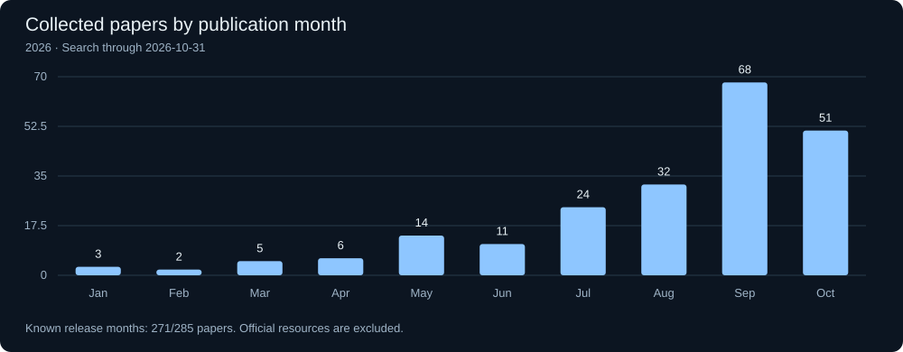

# Harness RSI

**A living literature collection on agent harness optimization and recursive self-improvement.**

Follow the methods, browse the papers, and track how this collection grows.

**177 papers & manuscripts · 10 official resources · 12 thematic categories**

Literature search cutoff: **2026-10-01** · Collection updated: **2026-10-03**

[Browse the bibliography](#literature-by-topic) · [BibTeX](data/literature.bib) · [Data & methodology](CONTRIBUTING.md) · [Suggest a paper](https://github.com/LucasXinYu/harness-rsi/issues/new?template=paper.yml)



The plot counts **included literature by release month**, using first arXiv submission when available and bibliographic publication dates otherwise. It includes older papers in the cumulative total. It is a view of our collection, not an estimate of every paper in the field. 173/177 papers have month-level or finer dates; the others remain listed and are excluded from this monthly plot.

## Scope

The focus is persistent changes to an agent’s harness: its executable workflow, prompts, tools, memory mechanisms, and improvement process. The collection also includes related search, memory, training, evaluation, and infrastructure work. **Inclusion does not mean that a method achieves recursive self-improvement.** Categories describe primary contributions, not RSI capability levels.

Sources and summaries are imported from our survey bibliography and Literature Map. This repository does not redistribute paper PDFs or contain the unpublished ACL manuscript. It is a curated working collection, not an exhaustive census or a replication of reported results.

## Collection growth

The initial import is a baseline, not historical evidence of when each paper was discovered. Future updates record dated snapshots; removals can reduce the total. Publication dates and `added_on` dates are kept separate.

| Snapshot | Papers | Official resources |
| :-- | --: | --: |
| 2026-10-03 | 177 | 10 |

## Explore locally

```sh
python3 -m http.server 8000 --directory docs
```

Open http://localhost:8000 for the searchable catalog, topic filters, monthly/quarterly publication views, and collection history. The static `docs/` directory is ready for GitHub Pages when public hosting is enabled.

## Literature by topic

| Topic | Records |
| :-- | --: |
| Surveys, Definitions, and Conceptual Frameworks | 12 |
| Harness Optimization and Search Workflows | 35 |
| Model and Policy Training, Harness Co-Evolution, and Distillation | 12 |
| Self-Modification and Meta-Level Improvement | 13 |
| Memory, Context, Skills, and Experience Reuse | 22 |
| Benchmarks for Harness Optimization and Adaptation | 5 |
| Generalization, Evaluation Methodology, and Safety | 24 |
| Agent Architectures and Harness Infrastructure | 20 |
| Prompt, Workflow, and Program Optimization | 14 |
| Task-Time Search and Output Refinement (Adjacent Work) | 4 |
| Downstream Task Benchmarks | 16 |
| Official Benchmark and Implementation Resources | 10 |

### Surveys, Definitions, and Conceptual Frameworks

- **[Generalized Agent Iteration: One Formal Framework for Iterative Policy Improvement and Recursive Self-Improvement](https://arxiv.org/abs/2609.13406v1)** (2026-09-11) — Formalizes iterative policy improvement and recursive self-improvement within a common framework. It examines whether the improvement mechanism is internal to the system and whether evaluation remains externally anchored.
- **[The Last AI Built by Humans: Toward Genuine Recursive Self-Improvement](https://arxiv.org/abs/2609.11873v3)** (2026-09-10) — Presents a roadmap toward recursive self-improvement and discusses the autonomy required for systems to improve themselves. Its conceptual dimensions provide related background, rather than the specific L1–L5 definitions adopted in our paper.
- **[Self-Improvements in Modern Agentic Systems: A Survey](https://arxiv.org/abs/2607.13104v1)** (2026-07-14) — Organizes self-improvement in agentic systems by the objects being updated and the feedback that drives updates. It supplies a broad comparison point for a narrower survey of persistent harness changes.
- **[Recursive Self-Improvement in AI: From Bounded Self-Refinement to Autonomous Research Loops](https://arxiv.org/abs/2607.07663v2)** (2026-07-08) — Reviews the progression from bounded self-refinement to autonomous research loops, including self-evaluation and feedback-driven revision. It helps distinguish local corrections from broader improvement processes.
- **[A Survey on Evaluation of LLM-based Agents](https://aclanthology.org/2026.findings-acl.1330/)** (2026-07) — Surveys agent evaluation through capabilities, application domains, generalist agents, benchmark dimensions, and evaluation frameworks. It identifies gaps in cost, safety, robustness, and fine-grained evaluation, providing the evaluation background for this survey.
- **[From Model Scaling to System Scaling: Scaling the Harness in Agentic AI](https://arxiv.org/abs/2605.26112v1)** (2026-05-25) — Frames agent capability in terms of system scaling and discusses context governance, trustworthy memory, and dynamic skill routing. It supplies architectural motivation for studying harnesses as an optimization target. Its research agenda is background for this survey, rather than evidence of an implemented recursively self-modifying optimizer.
- **[Code as Agent Harness](https://arxiv.org/abs/2605.18747v1)** (2026-05-18) — Examines code as the infrastructure surrounding language-model agents, including interfaces, execution mechanisms, and multi-agent coordination. It helps identify which software artifacts can serve as editable harness components.
- **[The Path to Recursive Self-Improving Agents: Foundation, Framework, and Future Directions](https://www.preprints.org/manuscript/202608.0051)** (2026) — Develops foundations and a framework for recursive self-improving agents, including five levels from manual improvement to general recursive improvement. Its distinction between a fixed improvement mechanism and an editable one anchors our level analysis.
- **[Agent Harness for Large Language Model Agents: A Survey](https://www.preprints.org/manuscript/202604.0428)** (2026) — Surveys the harness surrounding language-model agents as a system-level object. It provides related architectural coverage against which to position our emphasis on harness optimization and recursive improvement.
- **[Agent Harness Engineering: A Survey](https://picrew.github.io/LLM-Harness/)** (2026) — Proposes a seven-layer taxonomy covering execution, tooling, context, lifecycle, observability, verification, and governance. It maps the agent-harness ecosystem and provides an architectural comparison for our editable-component taxonomy.
- **[A Survey of Self-Evolving Agents: What, When, How, and Where to Evolve on the Path to Artificial Super Intelligence](https://arxiv.org/abs/2507.21046v4)** (2025-07-28) — Organizes self-evolving agents around what evolves, when evolution occurs, how it proceeds, and where it is applied. This broad taxonomy contextualizes our focus on the harness and its improvement controller.
- **[Towards AI That Improves Itself: A Survey of Recursive Self-Improvement](https://lee1003-lee.github.io/Awesome-RSI-Research/)** (n.d.) — Organizes improvement around proposal, feedback, and optimization, across behavior, agents, models/data, and research processes. It separates inheritance of improvements from the stronger claim that an inherited change improves the improver.

### Harness Optimization and Search Workflows

- **[ActiveSaddler: Automated Curriculum Learning for Agent Harness Optimization](https://arxiv.org/abs/2610.00906v1)** (2026-10-01) — Adapts the training curriculum alongside the harness through a non-stationary bandit. Recurrent failures create reusable pattern arms, estimated learning progress changes their priority, and exploration discovers new targets. GAIA2 and Terminal-Bench experiments compare it with the same harness optimizer under a fixed scenario order. It directly informs search, task selection, and experiment allocation; adaptive curriculum control is not necessarily self-rewriting controller code.
- **[Learning from Research: Toward Lifelong Agent Harness Evolution](https://arxiv.org/abs/2609.40169v1)** (2026-09-30) — ScholarEvolve draws proposal ideas from research publications rather than relying only on observed task failures and the editor's existing knowledge. It organizes directions by harness module, identifies strategies with topic modeling, and tests implementations and combinations. AppWorld and Tau2-Bench experiments support its research-guided evolution design; the intended ability to ingest future papers is distinct from demonstrating indefinite improvement.
- **[EvoGen-Harness: Learning Where and How to Evolve Image-Generation Harnesses](https://arxiv.org/abs/2610.00383v1)** (2026-09-30) — Evolves multiple responsibilities outside a frozen image generator. Trace aggregates stochastic execution evidence, uses failure attribution to prioritize candidate changes, and revisits residual failures as components change. A no-update option and held-out validation constrain adoption. It extends the task taxonomy to image generation and illustrates attribution-guided search; it is not evidence of model-weight training.
- **[Video-RSI: Recursive Self-Improvement of Video Understanding Agents via Harness Evolution](https://arxiv.org/abs/2609.37950v1)** (2026-09-29) — Uses the video agent's own language model to revise its executable observation harness. Active investigation returns to training videos for additional evidence that can distinguish competing failure explanations, rather than relying only on the original trace. Selection considers both answer quality and visual processing cost. It contributes a multimodal example of proposal-time evidence acquisition and cost-aware retention.
- **[Self-Evolving Harness on Multiple Tasks with the Agent as Its Own Optimizer](https://arxiv.org/abs/2609.38372v1)** (2026-09-29) — A single-author paper affiliated with Nanjing University. The solver and proposer use the same frozen model and current harness, with the proposer directly editing the code and evolution notes. Evolution mixes five benchmarks, followed by continual adaptation with replay; evaluation includes held-out tasks and five initially unseen benchmarks. Its pretraining/training terminology refers to external harness optimization, not weight updates. Acceptance checks runnability rather than requiring a measured performance improvement. The updated harness is reused by both roles in subsequent iterations, supporting discussion of partial recursion. The execution interface and outer scheduling remain fixed; task-score gains alone do not isolate an improvement in the proposer. This is a central reference for shared solver/proposer harnesses, data mixtures, transfer, and update scheduling.
- **[Mixture of Self-Improving Branches For Agent Harness Optimization](https://arxiv.org/abs/2609.37834v1)** (2026-09-29) — Optimizes harnesses through multiple self-improving branches with branch-specific development data and proposal policies. It contributes an exploration strategy for maintaining different improvement trajectories.
- **[MILO: Automated Harness Discovery via Orchestrated Multi-Agent Evolution](https://arxiv.org/abs/2609.38349v1)** (2026-09-29) — Evolves complete agent harnesses using island-based lineage trees, per-island mutators, and an orchestrator. The history retains rejected mutations as negative evidence. When progress stalls, the orchestrator can reassign mutators, graft lineages, preserve niches, and revise the search curriculum. This connects harness search with adaptation of its search configuration. The specified orchestration actions do not by themselves establish recursive rewriting of the orchestrator; capability-level claims require that distinction.
- **[HARDE: Optimizing Agent Harnesses for Runtime Risk Detection and Execution Control](https://arxiv.org/abs/2609.38291v1)** (2026-09-29) — Optimizes a runtime defense harness organized into trigger, monitor, and feedback modules. Isolated module probes first produce an optimization guide; subsequent iterations use safety and benign-task utility feedback to revise the harness. It extends the editable harness beyond task-performance components to runtime risk detection and execution control. Its contribution is safety-aware harness optimization, not evidence that the optimizer recursively rewrites itself.
- **[LiteEvo: Automated, Cost-Efficient Harness Evolution for Generalization to Unseen Tasks](https://arxiv.org/abs/2609.33146v1)** (2026-09-27) — Uses tool-free meta-agents to extract reusable components from execution traces, maintain a versioned library, and compose successive harnesses from a common neutral starting point. It reports both evolution-task results and a separate train/test generalization protocol. Useful for component reuse and optimization cost; sharing a neutral seed across benchmarks should not be confused with evolving one mixed-benchmark harness.
- **[MoMHa: Multi-Objective Optimization of LLM Harnesses over Accuracy, Safety, and Tokens](https://arxiv.org/abs/2609.30967v1)** (2026-09-25) — Optimizes harnesses jointly for accuracy, safety, and token cost. A scalarized reward combines these objectives when evaluating and accepting candidates, exposing trade-offs beyond task accuracy alone.
- **[RRSI: Regularized Recursive Self-Improvement of Agent Harnesses](https://arxiv.org/abs/2609.24972v2)** (2026-09-21) — Regularizes harness improvement through a shrinking edit budget, records of rejected attempts, and critic/pruner mechanisms. It evaluates coding, professional workspaces, and engineering settings; task diversity should be distinguished from evidence of optimizer self-modification.
- **[ModularRSI: Modular and Generalizable Recursive Harness Self-Improvement](https://arxiv.org/abs/2609.14857v1)** (2026-09-14) — Separates harness evolution into five independently editable modules and uses contrasting trajectories to guide changes. Benchmark-disjoint tasks make it relevant to modularity and generalization beyond the optimization setting.
- **[COBRA-Skills: Contextual Bandit-Guided Evolution for Agent Skill Optimization](https://arxiv.org/abs/2609.11682v1)** (2026-09-10) — Formulates skill optimization as budgeted sequential optimization over an evolving candidate population. Contextual bandits prioritize informative or promising evaluations, while execution feedback guides skill revision. It connects search organization to evaluation-budget allocation; the editable objects are reusable skills, not necessarily the entire runtime harness.
- **[HarnessEvolve: Learning from Reference Trajectories for Reliable Agent Self-Evolution](https://arxiv.org/abs/2609.00829v1)** (2026-09-01) — Diagnoses failures by aligning agent trajectories with reference trajectories generated using ground-truth answers, then clusters errors into reusable improvement targets. Separate execution, evaluation, optimization, and gating roles support harness edits. Quality screening targets leakage and prompt growth; performance screening checks current and recent batches, with held-out epoch selection. Relevant to diagnostic feedback and retention, but its privileged reference access must be distinguished from label-free self-evaluation.
- **[Verify Smarter, Evolve Further: Efficient Harness Evolution through Behavior-Aware Verification](https://arxiv.org/abs/2608.27311v1)** (2026-08-27) — Allocates verification effort through behavior-aware proposal screening and task selection. Paired checks and a second confirmation batch aim to improve the reliability and efficiency of accepting harness changes.
- **[JIT-Agent: Scaling Harness Intelligence via Just-in-Time Harness Evolution](https://arxiv.org/abs/2608.25593v2)** (2026-08-26) — Trains a harness generator through customization, repair, and evolution, using a fixed protocol for memory, planning, action, and capability orchestration. Prior configurations and execution feedback support harness adaptation. At deployment the generator remains fixed while traces can guide revisions to harnesses and their archive. It therefore supports discussion of learned proposers and just-in-time adaptation, rather than demonstrating continued recursive training of the generator.
- **[SBCO: Self-Supervised, Verifier-Grounded Harness Optimization For Planning Agents](https://arxiv.org/abs/2608.10157v1)** (2026-08-10) — Alternates improvements to a decomposed verifier bank and a harness policy through approximate block-coordinate ascent for constrained planning. The meta-agent remains fixed. This is a useful evaluator–policy optimization example and a boundary case separating closed-loop harness improvement from recursive modification of the optimizer.
- **[EvolveNet: Collaborative Harness Evolution for Agent Self-Improvement](https://arxiv.org/abs/2608.04968v1)** (2026-08-05) — Distributes a shared harness to deployments that evolve it on local workloads, then combines program adaptations and redistributes the result. Scope-typed, evidence-guided aggregation addresses conflicts between independently edited programs. It directly broadens update integration from selecting one candidate to composing distributed experience. Keeping workloads local is a system design choice, not by itself a formal privacy guarantee.
- **[HarnessCompass: Guiding Automatic Harness Evolution toward Generalizable and Effective Agent Harnesses](https://arxiv.org/abs/2608.01918v1)** (2026-08-03) — Uses reflections made before and after seeing outcome verdicts to guide edits to structural and guidance components. Candidate merging and simplification support reusable harnesses; proposed new capabilities remain hypotheses motivated by traces.
- **[Harness-R1: Learning to Edit Executable Runtime Harnesses from Agent Failure Trajectories](https://arxiv.org/abs/2608.02276v1)** (2026-08-03) — Trains an engineer to turn failure trajectories into executable runtime overlays, using supervised initialization followed by reinforcement learning. At deployment it generates a batch-conditioned overlay, rather than repeatedly rewriting its training procedure.
- **[DarwinX: Evolving Agent Harnesses Through Natural Selection](https://arxiv.org/abs/2608.07545v1)** (2026-07-31) — Uses natural-selection-inspired search over multiple harness lineages, with archives and recombination. It is relevant to population search and the reuse of improvements across branches.
- **[Recursive Harness Self-Improvement](https://arxiv.org/abs/2607.15524v1)** (2026-07-17) — Represents an agent loop as a prompt-level harness specification and revises it using pairwise feedback over revision history. It studies improvements to task-specific information flow and context management in research tasks.
- **[HarnessBank: Semantic Gene-Bank Search with Gated Verification for Agent-Harness Self-Evolution](https://arxiv.org/abs/2607.13683v2)** (2026-07-15) — Stores high-performing complete harnesses in a gene bank indexed by semantic coordinates and recombines candidates during search. Gated verification screens proposals. The archived object is a harness, rather than an isolated semantic unit; semantic activation alone is not causal evidence of improvement.
- **[MemoHarness: Agent Harnesses That Learn from Experience](https://arxiv.org/abs/2607.14159v1)** (2026-07-14) — Organizes harness experience into per-case records and distilled global patterns. Structured retrieval supports search and case-specific deployment adaptation from a frozen training bank without test-time feedback or extra search rounds.
- **[TTHE: Test-Time Harness Evolution](https://arxiv.org/abs/2607.08124v1)** (2026-07-09) — Evolves harnesses at test time using execution traces and available proxy feedback without revealing hidden labels. Candidate lineages, optional probes, and final selection illustrate the challenges of optimization under weak feedback.
- **[APEX: Adaptive Principle EXtraction A Three-Layer Self-Evolution Framework for Production AI Agents](https://arxiv.org/abs/2606.15363v1)** (2026-06-13) — Evolves three coupled targets: execution harnesses, reusable principles extracted from experience, and workflow topology. Principle memory is one component of a broader harness-evolution framework. Its three internal layers are not assignments to the RSI capability levels used in our survey.
- **[HarnessX: A Composable, Adaptive, and Evolvable Agent Harness Foundry](https://arxiv.org/abs/2606.14249v3)** (2026-06-12) — Presents a composable agent-harness framework with adaptation and trace-driven evolution. It connects modular system construction to feedback-driven changes.
- **[Self-Harness: Harnesses That Improve Themselves](https://arxiv.org/abs/2606.09498v3)** (2026-06-08) — Combines weakness discovery, targeted harness changes, and regression checks. Its editable scope extends beyond prompts, making it a useful example of evidence-guided software revision.
- **[Evolving Agents in the Dark: Retrospective Harness Optimization via Self-Preference](https://arxiv.org/abs/2606.05922v3)** (2026-06-04) — Optimizes harnesses without reference answers by retrospectively analyzing groups of trajectories and using self-preference feedback. It combines a difficulty/diversity coreset, diagnosis, post-execution scoring, and acceptance of positively scored changes.
- **[Adaptive Auto-Harness: Sustained Self-Improvement for Agentic System Deployment on Open-Ended Task Streams](https://arxiv.org/abs/2606.01770v2)** (2026-06-01) — Studies continued deployment on open-ended task streams through evolution and routing among multiple harnesses. It is relevant to sustained adaptation, but open-ended tasks alone do not establish general recursive capability.
- **[Continual Harness: Online Adaptation for Self-Improving Foundation Agents](https://arxiv.org/abs/2605.09998v1)** (2026-05-11) — Studies online harness adaptation with both a human-assisted configuration and an automated refiner. The two configurations help distinguish assisted editing from autonomous execution of an improvement loop.
- **[Agentic Harness Engineering: Observability-Driven Automatic Evolution of Coding-Agent Harnesses](https://arxiv.org/abs/2604.25850v4)** (2026-04-28) — Evolves coding-agent harnesses across seven editable components using layered diagnostic evidence. Change manifests, protected verification, and rollback connect proposed edits to expected benefits and regression risks.
- **[HARBOR: Automated Harness Optimization](https://arxiv.org/abs/2604.20938v1)** (2026-04-22) — Formulates harness configuration as constrained noisy Bayesian optimization over a bounded mixed-variable space. A structured surrogate, cost-aware multi-fidelity acquisition, trust regions, and a posterior safety constraint select configurations. It expands the search taxonomy beyond LLM-authored edits and trees, while remaining configuration optimization under a specified search procedure.
- **[Meta-Harness: End-to-End Optimization of Model Harnesses](https://arxiv.org/abs/2603.28052v1)** (2026-03-30) — Optimizes executable harnesses using access to candidate code, scores, and execution traces stored in a filesystem history. It illustrates end-to-end harness search with a fixed outer optimization procedure, including classification and mathematics applications.
- **[AutoHarness: improving LLM agents by automatically synthesizing a code harness](https://arxiv.org/abs/2603.03329v1)** (2026-02-10) — Synthesizes executable harness code using feedback from task environments. It illustrates automatic construction of the software controlling an agent, including game settings.

### Model and Policy Training, Harness Co-Evolution, and Distillation

- **[RSIGame: Autonomous Agentic Game Development with Recursive Self-improvement](https://arxiv.org/abs/2609.39045v1)** (2026-09-30) — Combines local exploration, diagnosis, and game revision with a global checkpoint and regression-monitoring loop. An evolving checklist carries testing guidance, and successful development experience is subsequently internalized through training. Included as an application and hybrid-learning reference: revisions to a generated game must be distinguished from revisions to the reusable improvement harness.
- **[R^2 Flow: Recursive Self-Improvement via Recursive Skill Evolution](https://arxiv.org/abs/2609.33867v1)** (2026-09-27) — Alternates policy learning, independent verification, and versioned skill-library changes on a shared-state orchestration graph. Separate measures of usage and signed utility prioritize edits, verifier evidence gates them, and a residual-variance plateau controls timing. Library revisions change the graph used by subsequent policy learning. Relevant to coupled learning/evolution, attribution, and scheduling; skill use is explicitly separated from evidence of benefit.
- **[Recursive Self-Improvement via On-Policy Distillation for Reasoning](https://arxiv.org/abs/2609.30652v1)** (2026-09-25) — Updates a privileged teacher alongside a reasoning student and combines this dynamic co-evolution with training on verified concise rewrites. The teacher receives ground-truth context. This is adjacent model-level self-distillation for mathematical reasoning, included to distinguish weight-space recursion from persistent harness revision rather than as direct evidence of harness RSI.
- **[Harness-Zero: Harness Distillation via Agent-as-Harness](https://arxiv.org/abs/2609.24974v1)** (2026-09-21) — Uses an agent guided by an optimized harness to review and correct student actions in the target harness action space, then fine-tunes the student on the resulting trajectories. The specialized guidance is removed at deployment. This is harness-to-weight distillation, rather than frozen-model harness editing. The reported experiments cover knowledge work, tool use, and science; the training appendix specifies separate domain-specific fine-tuning runs, so the macro-average is not evidence of one jointly trained universal model.
- **[ScienceBuddy: Recursive-in-Recursive Self-Improvement for Interactive Scientific Agents](https://arxiv.org/abs/2609.17523v1)** (2026-09-15) — Studies scientific agents through research workspaces and coupled harness/model updates. It connects reusable research procedures with learning from scientific interaction.
- **[NeoHorse-1: Towards Recursive Self-Improvement via Agentic Post-Training with Routing Harness](https://arxiv.org/abs/2609.08183v1)** (2026-09-08) — Uses a routing harness to collect agentic experience and guide post-training and data curricula. It connects execution-time routing to model learning; routing-derived training data should not by itself be described as autonomous rewriting of the harness.
- **[Co-Evolving Harnesses and Models: On-Policy Correction Helps Weaker Models Catch Up Where Imitation Fails](https://arxiv.org/abs/2609.09134v1)** (2026-09-08) — Finds that copying full expert trajectories can degrade a weaker model operating under its evolved harness. It instead identifies a failing turn in the weaker model's own rollout and requests a localized expert correction for training. The enterprise-task study makes model–harness compatibility a concrete issue in joint evolution, rather than assuming weight and harness improvements add independently.
- **[WHALE: A Simple Recipe for Joint Harness-Weight Optimization](https://arxiv.org/abs/2609.00196v1)** (2026-08-31) — Alternates optimization of executable harnesses and model weights. It is relevant to joint adaptation of the underlying model and the runtime that exposes its capabilities.
- **[Co-Harness: Co-Evolving Harnesses and Model Weights for LLM Agents](https://arxiv.org/abs/2607.22688v1)** (2026-07-17) — Alternates harness optimization with model fine-tuning for AI research agents. A HarnessCritic diagnoses failed trajectories and proposes validated local changes; the updated harness generates trajectories for subsequent weight updates. It is a direct joint-optimization reference, useful for contrasting co-evolution with one-way harness distillation and purely frozen-model harness search.
- **[SIA: Self Improving AI with Harness & Weight Updates](https://arxiv.org/abs/2605.27276v2)** (2026-05-26) — Combines updates to an agent's harness with updates to model weights. It expands the improvement target beyond runtime software and provides a case for examining how the two update channels interact.
- **[Harnessing LLM Agents with Skill Programs](https://arxiv.org/abs/2605.17734v2)** (2026-05-18) — Represents skills as executable Program Functions that activate in relevant failure states, modify actions, or inject context. These functions support inference-time intervention, training supervision, and controlled skill growth from remaining failures, with executable validation and teacher review. The evolving objects are primarily task-execution skills. They should be distinguished from meta-skills that implement the improvement procedure itself, such as the context-engineering skills evolved by MCE.
- **[Absolute Zero: Reinforced Self-play Reasoning with Zero Data](https://arxiv.org/abs/2505.03335v3)** (2025-05-06) — Uses reinforced self-play to generate tasks and learn from verifiable rewards without an external task dataset. It is adjacent model/data evolution, rather than direct evidence of editing a harness optimizer.

### Self-Modification and Meta-Level Improvement

- **[Recursive self-improvement of AI research agents](https://arxiv.org/abs/2609.26457v1)** (2026-09-22) — AIDE^2 optimizes a research agent through nested code-search and agent-rewrite loops. The discovered agent changes strategy selection and context management; the main outer driver and incumbent rule remain fixed, with a separate ignition experiment testing an evolved outer driver. That experiment does not establish superior sample efficiency of the evolved improver. Reusing an edited inner codebase is therefore distinguished from automatically replacing the outer rewriter after every update.
- **[Dream-RSI: Recursive Self-Improvement through Evolving Worlds](https://arxiv.org/abs/2609.14858v1)** (2026-09-14) — Evolves an orchestration layer over a fixed coding agent, using replay from historical search trees and fresh online interaction. It connects changes in the improvement environment with changes in reusable agent control.
- **[Meta^n: Recursive Self-Improvement through Emergent Depth](https://arxiv.org/abs/2608.24735v1)** (2026-08-25) — Repeatedly applies a fixed meta-operation to an expanding solver stack, adding strategic preprocessing and callable helpers. An evolutionary archive searches layer chains; increasing depth should not be confused with modifying the fixed meta-operation itself.
- **[Hierarchical Self-Improvement: A Framework for Task-Specific Evolvable Agent Harnesses](https://arxiv.org/abs/2608.08466v1)** (2026-08-09) — Separates task-harness evolution from meta-level changes to the evolver's strategy code. The outer meta-evolver remains fixed, making the boundary of recursion explicit.
- **[MetaSkill-Evolve: Recursive Self-Improvement of LLM Agents via Two-Timescale Meta-Skill Evolution](https://arxiv.org/abs/2607.05297v1)** (2026-07-06) — Uses fast task improvement and slower updates to branch-local meta-skills. The editable meta-skills support analysis of partial recursion, while the outer scheduling procedure remains predefined.
- **[The Last Harness You'll Ever Build](https://arxiv.org/abs/2604.21003v3)** (2026-04-22) — Presents a two-level design: an inner worker/evaluator/editor loop improves a task harness, while an outer loop optimizes the evolution blueprint across tasks. This is a direct conceptual reference for making the improvement procedure an optimization target. Its broad domain-adaptation ambition should not itself be treated as proof of general or unbounded RSI.
- **[Hyperagents](https://arxiv.org/abs/2603.19461v1)** (2026-03-19) — Makes both task-agent code and meta-level modification code editable. It investigates transfer and continued recursive improvement; improvements in the latter setting should be interpreted with the paper's reported statistical uncertainty.
- **[Meta Context Engineering via Agentic Skill Evolution](https://arxiv.org/abs/2601.21557v2)** (2026-01-29) — Evolves context-engineering skills at a meta level and executes those skills to optimize context artifacts at a base level. Agentic crossover uses prior skills and their outcomes, while a fixed (1+1) evolutionary strategy controls the outer loop. Unlike growth of task-execution skills alone, the editable skills implement an improvement procedure, making this a direct reference for partial meta-level improvement.
- **[Huxley-Gödel Machine: Human-Level Coding Agent Development by an Approximation of the Optimal Self-Improving Machine](https://arxiv.org/abs/2510.21614v3)** (2025-10-24) — Organizes coding-agent development through lineages, clade productivity, and Thompson-sampling-based parent selection. It separates expansion from evaluation and studies self-modification, while retaining fixed parts of the search controller.
- **[Gödel Agent: A Self-Referential Agent Framework for Recursively Self-Improvement](https://aclanthology.org/2025.acl-long.1354/)** (2025-07) — Implements a self-referential agent that can modify its runtime logic through code changes and monkey patching. Subsequent recursive calls can execute the updated logic, making persistence of controller changes central to the method.
- **[Darwin Godel Machine: Open-Ended Evolution of Self-Improving Agents](https://arxiv.org/abs/2505.22954v3)** (2025-05-29) — Maintains an archive of coding agents that can modify their own implementations and produce improved descendants. Selection uses performance and lineage information, providing an example of open-ended evolution in which improved agents participate in later modifications.
- **[A Self-Improving Coding Agent](https://arxiv.org/abs/2504.15228v2)** (2025-04-21) — Builds a coding agent that iteratively improves its own implementation. It selects the next meta-agent from an archive using a utility that includes performance, runtime, and cost.
- **[Self-Taught Optimizer (STOP): Recursively Self-Improving Code Generation](https://arxiv.org/abs/2310.02304v3)** (2023-10-03) — Uses a language model to improve a code-generation optimizer and applies the resulting optimizer in later iterations. The language model itself stays fixed, enabling a precise discussion of recursion in software rather than model weights.

### Memory, Context, Skills, and Experience Reuse

- **[MemCodex: Self-Programming Hierarchical Memory for Language Agents](https://arxiv.org/abs/2609.39765v1)** (2026-09-30) — Rewrites executable memory-layer programs governing construction, indexing, retrieval, and routing. Hierarchical reads proceed from coarse to fine and can fall back to original history. This is directly relevant to evolution of the memory-management procedure, rather than only accumulation of memory contents. The preprint is marked work in progress.
- **[NavHarness: Towards Lifelong Embodied Navigation](https://arxiv.org/abs/2609.34276v1)** (2026-09-28) — Carries maps, task records, and house knowledge between navigation sessions, checking them against new observations and consolidating corrections. Structured recovery handovers and outcome summaries support later reuse without weight training. It provides a recent embodied-memory example, with the distinction that accumulating or correcting task experience does not by itself demonstrate an evolving optimizer.
- **[GenMem: Generative Symbolic Memory for Self-Evolving Harness](https://arxiv.org/abs/2609.34633v1)** (2026-09-28) — Uses stable symbolic identifiers to address memories whose contents can change. A retriever and an evolver learn memory access and revision through GRPO with process and outcome rewards. Relevant to memory addressing and learned management policies; its training component should not be described as purely weight-frozen harness search.
- **[Recursive Harness Distillation across Agents for Robot Manipulation](https://arxiv.org/abs/2609.33378v1)** (2026-09-27) — A stronger agent converts intervention experience into a reusable playbook for a lighter robot agent, then revises the playbook using execution feedback. The playbook transfers across agents and manipulation instances without model-weight updates. This is external experience distillation, distinct from the weight distillation of Harness-Zero.
- **[Self-Evolving Search Index](https://arxiv.org/abs/2609.19656v1)** (2026-09-17) — SELF-INDEX diagnoses retrieval failures, selectively revises document index keys, and validates revisions before updating the index. This supplies a concrete example of evolving the retrieval substrate. It is adjacent to harness memory management, not evidence that the complete agent or its optimizer recursively modifies itself.
- **[RSIAgent: Autonomous Exploration for Recursive Self-improvement in New Environments](https://arxiv.org/abs/2609.15364v2)** (2026-09-14) — Explores new environments and accumulates reusable experience or memory for later problem solving. Its relevance is environment-driven adaptation; the name alone does not determine an RSI level.
- **[CHIME: Credit-Aware Hierarchical Memory Evolution for Long-Horizon Agentic Planning](https://arxiv.org/abs/2609.02074v1)** (2026-09-02) — Separates planning memory from execution memory. Before storing experience, it attributes outcomes to planning, execution, both, or neither, then updates the corresponding bank. It supports discussion of credit assignment and selective memory updates without parameter training; outcome attribution should not be equated with an independently established causal effect.
- **[Filesystem-Based Memory for LLM Agents: Organization, Evolution, and Sustainability](https://arxiv.org/abs/2607.26637v1)** (2026-07-29) — Studies management, search, and execution roles around filesystem memory, comparing curated hierarchies, verbatim logs, and chunk retrieval. Organization can reduce retrieval cost without consistently improving correctness, and its sustainability depends on model and tool choices.
- **[SkillOpt: Executive Strategy for Self-Evolving Agent Skills](https://arxiv.org/abs/2605.23904v2)** (2026-05-22) — Optimizes a skill document as external state of a frozen agent. A separate optimizer converts scored rollouts into bounded add/delete/replace edits, with strict validation improvement required for acceptance. Edit budgets, rejected-edit memory, and slower epoch-level updates connect it to regularization, memory, and scheduling. It is component-level text optimization rather than evidence that the entire harness or optimizer rewrites itself.
- **[EvolveMem:Self-Evolving Memory Architecture via AutoResearch for LLM Agents](https://arxiv.org/abs/2605.13941v1)** (2026-05-13) — Exposes retrieval configuration, including scoring, fusion, context budgets, and answer-generation choices, to diagnosis-driven updates. Validation and revert-on-regression safeguards screen changes. Memory extraction populates the store; the explicit search target is the retrieval configuration.
- **[MemEvolve: Meta-Evolution of Agent Memory Systems](https://arxiv.org/abs/2512.18746v1)** (2025-12-21) — Jointly evolves experiential knowledge and memory architecture. EvolveLab exposes encoding, storage, retrieval, and management as a modular design space. It provides a direct predecessor for memory-system evolution and distinguishes changes to stored experience from changes to the mechanism that manages it.
- **[Remember Me, Refine Me: A Dynamic Procedural Memory Framework for Experience-Driven Agent Evolution](https://arxiv.org/abs/2512.10696v1)** (2025-12-11) — ReMe distills success patterns, failure triggers, and comparative experience; retrieves through scenario-aware indexing; and refines the pool by adding useful memories and pruning outdated ones. It supports lifecycle-level memory management and procedural experience reuse. ReMe is distinct from the ReMem baseline in Evo-Memory.
- **[Evo-Memory: Benchmarking LLM Agent Test-time Learning with Self-Evolving Memory](https://arxiv.org/abs/2511.20857v1)** (2025-11-25) — Evaluates memory across sequential task streams, requiring retrieval and updates after interactions. ExpRAG reuses past experience, while ReMem combines reasoning, actions, and memory refinement. Relevant to measuring continuing adaptation rather than static conversational recall. This entry summarizes version 1; a later version exists.
- **[Agentic Context Engineering: Evolving Contexts for Self-Improving Language Models](https://arxiv.org/abs/2510.04618v3)** (2025-10-06) — Maintains and incrementally refines a context playbook using experience. It treats accumulated context as an evolving artifact that can influence subsequent task execution.
- **[ReasoningBank: Scaling Agent Self-Evolving with Reasoning Memory](https://arxiv.org/abs/2509.25140v2)** (2025-09-29) — Distills reusable reasoning lessons from successful and failed trajectories into memory. Later retrieval reuses those lessons to support new tasks.
- **[Agent KB: Leveraging Cross-Domain Experience for Agentic Problem Solving](https://arxiv.org/abs/2507.06229v5)** (2025-07-08) — Provides infrastructure for retrieving and reusing experience across agent frameworks and domains. It supports cross-domain knowledge reuse without necessarily modifying the improvement controller.
- **[Dynamic Cheatsheet: Test-Time Learning with Adaptive Memory](https://arxiv.org/abs/2504.07952v1)** (2025-04-10) — Accumulates an adaptive memory of useful information and strategies during test-time learning. The persistent cheatsheet provides a lightweight update surface outside model weights.
- **[SkillWeaver: Web Agents can Self-Improve by Discovering and Honing Skills](https://arxiv.org/abs/2504.07079v1)** (2025-04-09) — Discovers, practices, and refines web-interaction skills, exposing them as reusable APIs. It illustrates how executable skills can become persistent components of an agent's toolset.
- **[Agent Workflow Memory](https://arxiv.org/abs/2409.07429v1)** (2024-09-11) — Induces reusable workflows from experience and retrieves them during web-agent execution. It links procedural memory to repeated task performance.
- **[Large Language Models as Tool Makers](https://arxiv.org/abs/2305.17126v2)** (2023-05-26) — Uses language models to construct and cache reusable tools for solving tasks. It provides a mechanism for extending an agent's capabilities through persistent executable artifacts.
- **[Voyager: An Open-Ended Embodied Agent with Large Language Models](https://arxiv.org/abs/2305.16291v2)** (2023-05-25) — Builds an open-ended Minecraft agent with an expanding library of executable skills. Skill retrieval and composition support reuse, while recursive modification of the skill-learning procedure is a separate question.
- **[Reflexion: Language Agents with Verbal Reinforcement Learning](https://arxiv.org/abs/2303.11366v4)** (2023-03-20) — Uses verbal feedback and episodic memory to improve an agent across attempts without updating model weights. It illustrates feedback reuse, while leaving stronger claims about optimizer self-modification separate.

### Benchmarks for Harness Optimization and Adaptation

- **[EvoHarnessBench: Can Your Agents Keep Pace with an Evolving Harness?](https://arxiv.org/abs/2609.04280v3)** (2026-09-03) — Changes the available harness externally and evaluates an agent's adaptation and retention. This differs from asking the agent to design the harness changes itself.
- **[HarnessDev: Can LLMs Create and Evolve Their Own Agent Harness?](https://arxiv.org/abs/2609.01437v1)** (2026-09-01) — Evaluates whether language models can create and evolve agent harnesses. Hidden tasks and efficiency measures make it relevant to assessing harness-engineering capability rather than just final task performance.
- **[HarnessRisk: A Lifecycle-Oriented Benchmark for Agent Harness Safety](https://arxiv.org/abs/2608.17597v1)** (2026-08-18) — Introduces a lifecycle-oriented harness-safety benchmark spanning configuration, extension, runtime, persistence, action control, and incident recovery. Sandboxed cases assess utility, attack success, persistence, and detection. The benchmark can inform safety evaluation of evolved harnesses, but it is not itself a harness-improvement algorithm or a dedicated test of recursive improvement.
- **[Evo-Bench: Can Language Models Improve Agent Harness?](https://arxiv.org/abs/2608.09096v2)** (2026-08-10) — Benchmarks whether language models can improve an existing agent harness. Its evaluation object is the harness-editing capability of the candidate optimizer.
- **[HarnessOpt-Bench: Evaluating LLMs at Harness Optimization](https://arxiv.org/abs/2608.06301v1)** (2026-08-06) — Evaluates harness optimization across four downstream tasks with explicit budgets and final-candidate nomination. Test evaluation is unavailable during search, helping separate optimization feedback from held-out performance.

### Generalization, Evaluation Methodology, and Safety

- **[Scale and Selection: What Makes Automatic Harness Evolution Work for Visual-Interface Robot Agents](https://arxiv.org/abs/2609.39304v1)** (2026-09-30) — Studies how rollout batch size and candidate selection affect automatically evolved robot-agent harnesses. Larger batches improve the evidence behind promotion, while a strict champion/challenger rule performs better than unconditional acceptance in the reported setting. Relevant to evaluation noise, resource allocation, and regression prevention; repeated use of a fixed selection set remains distinct from held-out assessment.
- **[How Much of a Harness Does a Strong Agent Need for Autonomous ML Engineering?](https://arxiv.org/abs/2609.40303v1)** (2026-09-30) — Compares elaborate open-source MLE harnesses with a minimal coding-agent session using the same frontier model and time budget. The evaluated systems do not outperform the minimal baseline, and ablations question the value of extra orchestration in those settings. Relevant to budget-matched baselines and complexity; the conclusion is specific to the studied MLE tasks, not a universal rejection of harness engineering.
- **[Harness Evolution as Learning: Approximation, Generalization, and Optimization Limits of Self-Improving Personal Agents](https://arxiv.org/abs/2609.36892v1)** (2026-09-29) — Studies personal-agent harness architecture, scale, and evolution algorithms using a preference-oriented benchmark and a learning-theoretic formulation. Approximation, generalization, and optimization errors organize limits imposed by reachable policies, finite evidence, and biased updates. Useful for explaining why larger harnesses or more evolution rounds need not yield better personalization.
- **[SEABench: Benchmarking Endogenous Misalignment In Self-Evolving Agents](https://arxiv.org/abs/2609.35596v2)** (2026-09-28) — Evaluates safety failures emerging from persistent self-evolution across 48 longitudinal task sequences involving instructions, memory protocols, tools, and skills. Paired non-evolving agents support attribution of failures to evolution. Relevant to long-term safety evaluation across update surfaces rather than only immediate task-score gains.
- **[SAGE: A Statistical Acceptance Gate for Self-Evolving Agents](https://arxiv.org/abs/2609.36043v1)** (2026-09-28) — Compares candidate and incumbent skills on the same validation items. Acceptance requires positive regression-weighted gain, a one-sided paired significance test against the corresponding break-even threshold, and a cap on the fraction of previously solved items that regress. This SAGE is the statistical-gate paper, distinct from other methods with the same acronym.
- **[MetaBench-Harness: Unlocking End-to-End Optimization of Benchmark Harnesses](https://arxiv.org/abs/2609.33411v1)** (2026-09-27) — Optimizes the workflow used to generate benchmarks. The evolving artifact is a benchmark-generation harness, rather than a downstream task-solving agent harness.
- **[Compositional Safety Failures in Harness Evolution: Identification and Runtime Monitoring](https://arxiv.org/abs/2609.33123v2)** (2026-09-27) — Investigates safety failures caused by combinations of harness-component updates and studies runtime monitoring. It shows why validating edits independently may miss interactions after integration.
- **[Beyond the Model: Demystifying Harness Effects in Software Engineering Agents](https://arxiv.org/abs/2609.32459v1)** (2026-09-26) — Studies software-engineering agent performance across models, benchmarks, and harnesses, and analyzes components through NanoHarness. The results motivate treating harness effects as dependent on the model and task, rather than assuming that adding components always helps. It provides empirical context for evaluating optimized harnesses, not a recursive harness-optimization method.
- **[Evolutionary Safety of Recursive Self-Improving AI: Taxonomy, Risk Discovery, and Evaluation](https://arxiv.org/abs/2609.31186v1)** (2026-09-25) — Develops a taxonomy of safety risks in recursive improvement and discusses risk discovery and evaluation. It provides a conceptual structure for safety analysis rather than a universal safety guarantee.
- **[Automatic Harness Evolution for Hardware Design Verification: Can LLMs Consolidate Gains Across Discovered Harnesses?](https://arxiv.org/abs/2609.28908v1)** (2026-09-24) — Examines harness evolution around a fixed model on proprietary hardware-verification tasks. Better completion and any-hit coverage do not consistently consolidate into stronger repeatable correctness, and selected validation gains can disappear on replay. A separate repair case study explores cross-benchmark behavior. Relevant to archives, metric choice, regression, and the distinction between complementary specializations and a uniformly better harness.
- **[What Stops Recursive Self-Improvement in Robotics? Lessons from 123 Rounds of Agentic Skill Discovery](https://arxiv.org/abs/2609.31760v1)** (2026-09-23) — Analyzes 123 rounds of agentic robotic skill discovery and the obstacles to compounding progress. Local skill improvements did not necessarily accumulate into success on the target objective.
- **[Skill Issue: Lessons from Optimizing Repository SKILLs for Coding Agents](https://arxiv.org/abs/2609.12742v1)** (2026-09-11) — Builds repository-specific optimization tasks from merged pull requests reverted at a fixed base commit and evaluates the incremental value of a skill document. Across three Kotlin repositories, apparent gains from GEPA are not separable from run-to-run variance at the available sample size, while SkillOpt yields little change. It is useful counterevidence to treating a plausible-looking skill or a small score increase as a reliable improvement.
- **[A Theory of Reliable Self-Evolution for Agent Harnesses](https://arxiv.org/abs/2609.08175v2)** (2026-09-08) — Develops conditions and a validation rule for reliably adopting harness changes while preserving previously successful behavior. It analyzes how verification and evaluation costs limit progress and how observed performance shifts can diagnose stagnation. These are conditional theoretical guarantees, not a universal empirical safety certificate. Version 2, revised September 28, replaces the earlier title Safe Harness Self-Evolution: A Theoretical Analysis of Feasibility and Limits; the two titles denote one paper.
- **[SafeEvolve: Harness-Policy Co-Evolution from Agent Experience for Safety Alignment](https://arxiv.org/abs/2609.02786v1)** (2026-09-02) — Combines safety-related harness evolution with policy training through supervised fine-tuning and reinforcement learning on agent experience. Relevant to both safety evaluation and model–harness co-evolution; policy updates here include learned model parameters, rather than only textual behavioral guidance.
- **[LLM-as-a-Judge Is Not an Oracle: Why Self-Improving Agents Need Deterministic Guardrails](https://arxiv.org/abs/2609.02246v1)** (2026-09-02) — A position and system report describing evaluation failures in prompt-optimization loops and the PROCTOR architecture. Deterministic gates, role separation, isolated evaluation, frozen holdouts, and canary cases constrain judge-driven updates. Use as a reported design and failure analysis, not a general proof that these safeguards eliminate reward hacking.
- **[Auditing Harness Tampering in Self-Improving Agents](https://arxiv.org/abs/2609.00069v1)** (2026-08-30) — Audits whether harness changes compromise evaluation, permissions, or provenance. It highlights the need to protect the evidence used to decide whether an apparent improvement is valid.
- **[Auditing Self-Evolution in Financial Agents: Capability Gains, Security Drift, and Execution-Interface Mismatch](https://arxiv.org/abs/2608.17684v1)** (2026-08-18) — Audits self-evolving financial agents for capability gains, security drift, and execution-interface mismatch. It distinguishes attack exposure and conditional success from aggregate risk.
- **[SHE: Trajectory-driven Safety Harness Evolution for LLM Agents](https://arxiv.org/abs/2608.09885v1)** (2026-08-10) — Uses trajectories and attribution to evolve safety harness artifacts. It provides a concrete feedback-to-safety-update workflow for agent systems.
- **[One Recipe, Many Harnesses: What Self-Evolution Encodes Across Languages and Models](https://arxiv.org/abs/2608.10178v1)** (2026-08-10) — Studies what evolved harnesses encode and how their improvements transfer across programming languages and base models. It supplies evidence relevant to the scope of harness generalization.
- **[Model or Harness? An Interaction-Centric Taxonomy for Localizing Agent Failures](https://arxiv.org/abs/2607.28802v1)** (2026-07-30) — Localizes agent failures through interaction edges and fault ownership, distinguishing model, harness, environment, and grader failures. The taxonomy provides a vocabulary for deciding whether a failure warrants a harness edit or a different intervention. It supports diagnosis and evaluation design; the taxonomy alone does not implement an autonomous RSI proposal loop.
- **[Agent Harness Distillation: Inference-Time Harness Extraction and Exploitation in Autonomous Multi-Agent Systems](https://arxiv.org/abs/2607.28147v4)** (2026-07-30) — Studies black-box extraction of another agent system's inference-time harness behavior. An initial inferred harness is refined to match target behavior, and a deception-based defense is evaluated. Included as security and intellectual-property context: its use of distillation concerns behavioral extraction, not Harness-Zero's student-weight training or autonomous improvement of one's own harness.
- **[Rethinking the Evaluation of Harness Evolution for Agents](https://arxiv.org/abs/2607.12227v2)** (2026-07-14) — Examines evaluation of harness evolution under matched feedback and inference budgets and held-out testing. It helps separate benefits of an improved harness from benefits of additional search or compute.
- **[Harness Updating Is Not Harness Benefit: Disentangling Evolution Capabilities in Self-Evolving LLM Agents](https://arxiv.org/abs/2605.30621v1)** (2026-05-28) — Separates the ability to generate a useful update from the ability to benefit from it during execution. It examines cases where an update is not activated or followed, informing evaluation of retained changes.
- **[Stop Comparing LLM Agents Without Disclosing the Harness](https://arxiv.org/abs/2605.23950v1)** (2026-05-07) — Argues that agent comparisons should disclose their harness and separate model effects from system effects. Its binding-constraint thesis concerns particular long-horizon settings with comparably capable models. This is a methodological position supporting transparent comparison; it should not be cited as experimental proof that harness design universally dominates model capability.

### Agent Architectures and Harness Infrastructure

- **[Schema: Discovering Unknown Environments via Agentic Program Induction](https://arxiv.org/abs/2609.39140v1)** (2026-09-30) — Maintains an executable program workspace representing learned environment rules. Interfaces check programs against interaction history, support planning, and verify execution step by step. It is relevant infrastructure for structured experience and environment discovery; revising an environment model within the harness is not automatically revision of the harness optimizer.
- **[DynaHarness: A Dynamic Physical Harness for Self-Evolving Robot Agents](https://arxiv.org/abs/2609.40306v1)** (2026-09-30) — Connects slower semantic planning with faster physical execution through an explicit execution contract around a frozen VLA. Recorded failures guide changes to reusable capabilities or execution mechanisms, and paired regression checks govern adoption. It supplies a robotics example of failure localization, runtime control, and gated persistent revision; the reported manipulation results do not establish unrestricted self-modification of the optimizer.
- **[SCLATE: a Substrate for Continual-Learning Agent Training and Evaluation](https://arxiv.org/abs/2609.32391v2)** (2026-09-26) — Provides a shared event scheduler for benchmark events and agent-side activity such as session changes and memory consolidation. Its rollout engine supports unmodified harnesses and memory systems, enabling controlled comparisons and model post-training. Relevant to scheduling and evaluation infrastructure; its weight-training results should not be described as autonomous harness-code evolution.
- **[Breaking the Environment Wall: Evolving LLM Agent Environments for Recursive Self-Improvement](https://arxiv.org/abs/2609.29773v1)** (2026-09-24) — Env-Rethink organizes files and evidence through collection maps and event logs, uses a post-trained model to identify environmental noise, and produces changed environments through virtual event histories. This is related environment preparation and evolution, not interchangeable with editing the task-agent harness. This entry records version 1 and its title.
- **[RegenHarness: A Robot Agent Harness with Evidence-Gated Recursive Self-Improvement](https://arxiv.org/abs/2609.27612v1)** (2026-09-23) — Develops a robot-agent harness with evidence-gated execution and improvement. It highlights the role of checks around updates in an embodied setting.
- **[Auto-RecSys: Harnessing Autonomous Research Agents for Industry-Scale Recommender System](https://arxiv.org/abs/2609.10922v1)** (2026-09-10) — Combines asynchronous experiments, shared cross-server memory, and separation of natural-language skills from deterministic execution scripts. Execution playbooks retain operational experience while an idea loop uses experimental results to guide future proposals. It supports experiment-management and experience-reuse discussions; two loops alone do not establish recursive optimizer evolution.
- **[Prime Agent: A Self-Improving RLM Harness](https://arxiv.org/abs/2608.23552v1)** (2026-08-24) — Combines a persistent IPython environment with recursive language-model context processing and a continual harness that retains histories, memory, skills, prompts, and subagents. It is relevant to the state and infrastructure available for continued adaptation. Recursive calls for context processing or subagent execution should not be equated with recursive improvement of the optimizer.
- **[EnvHarness: Awakening Static Worlds for Agent Learning](https://arxiv.org/abs/2608.19880v1)** (2026-08-20) — Adds environment-side wrappers and task shaping to support agent learning. Its editable object is the environment harness, which should be distinguished from the task-solving agent's own controller.
- **[Task-Aware Harness Provisioning for LLM Agents in Mission-Critical Infrastructure Operations](https://arxiv.org/abs/2608.17433v1)** (2026-08-18) — Matches infrastructure-operation tasks to harness resources using task-to-harness mappings. Map-guided escalation begins with task-specific provision and expands to full provision after a failed self-check. This is useful for comparing runtime configuration with persistent harness evolution. Selecting or escalating a configuration does not alone show that a reusable improvement mechanism has been modified.
- **[HELIX: Model-Harness Co-evolution for Recursive Self-Improvement](https://arxiv.org/abs/2608.13951v1)** (2026-08-14) — Provides a source-traceable substrate for a proposed build–update–rebuild loop between models and harnesses. The reported evaluation includes one 65-candidate harness-evolution round and exports verified sibling trajectories as training records. These results support the execution and data-handoff stages; they should not be read as a demonstrated sequence of repeated model-training and harness-rebuilding rounds.
- **[LongHorizon-Harness: Advancing Long-Horizon Agents for Real-World Tasks](https://arxiv.org/abs/2608.01964v1)** (2026-08-03) — Uses a Manage–Execute–Audit loop with external task state, fresh executor contexts, and a read-only auditor that checks environment facts. Adapters support different models and existing agent backends. Included as harness architecture and verification context; improving execution through this fixed organization is distinct from automatically evolving the organization itself.
- **[Harness Engineering: Anatomy, Architecture, and Evolution of Coding Agents – A Source-Code Study of Eleven Systems](https://arxiv.org/abs/2609.00006v1)** (2026-07-15) — Analyzes source code from eleven coding-agent systems to describe harness anatomy, architecture, and evolution. It provides empirical architectural background for identifying editable components.
- **[Harness Handbook: Making Evolving Agent Harnesses Readable,Navigable, and Editable](https://arxiv.org/abs/2607.13285v1)** (2026-07-14) — Provides representations that make an evolving harness easier to read, navigate, and edit, including links from behavior to code. It addresses how an editor finds the implementation relevant to an observed failure.
- **[Meta-Engineering Harnesses for AI-Native Software Production: A Contract-Driven Adversarial Verification Architecture with Early Deployment Report](https://arxiv.org/abs/2605.25665v1)** (2026-05-25) — Combines explicit contracts, role-specialized agents, independent adversarial verification, structured failure classification, and outer-loop calibration for software production. An early deployment report describes improvements motivated by observed failures. It informs verification and engineering practice, but the deployment evidence should not be treated as establishing autonomous recursion or a high RSI capability level.
- **[SemaClaw: A Step Towards General-Purpose Personal AI Agents through Harness Engineering](https://arxiv.org/abs/2604.11548v1)** (2026-04-13) — Develops a general-purpose personal-agent framework through harness engineering. It serves as an architectural example of the runtime surrounding a language model.
- **[The AI Scientist-v2: Workshop-Level Automated Scientific Discovery via Agentic Tree Search](https://arxiv.org/abs/2504.08066v1)** (2025-04-10) — Extends automated scientific discovery with agentic tree search over experiments. It illustrates experiment-level search whose nodes and evaluation differ from search over agent harnesses.
- **[The AI Scientist: Towards Fully Automated Open-Ended Scientific Discovery](https://arxiv.org/abs/2408.06292v3)** (2024-08-12) — Automates stages of scientific research, including generating ideas, running experiments, and reporting results. It provides a research-agent architecture, rather than automatic evidence that the research controller rewrites itself.
- **[SWE-agent: Agent-Computer Interfaces Enable Automated Software Engineering](https://arxiv.org/abs/2405.15793v3)** (2024-05-06) — Designs an agent-computer interface for software engineering, including repository navigation, editing, and feedback. It demonstrates the importance of interface design; editing a task repository is distinct from editing that interface.
- **[AutoGen: Enabling Next-Gen LLM Applications via Multi-Agent Conversation](https://arxiv.org/abs/2308.08155v2)** (2023-08-16) — Provides a framework for coordinating agents through conversation and configurable interaction patterns. It is infrastructure for building multi-agent workflows rather than, by itself, a recursive improvement method.
- **[ReAct: Synergizing Reasoning and Acting in Language Models](https://arxiv.org/abs/2210.03629v3)** (2022-10-06) — Interleaves language-model reasoning with actions and observations. It supplies a manually designed execution-loop baseline against which persistent harness modifications can be compared.

### Prompt, Workflow, and Program Optimization

- **[SelfOp: An Optimization Algorithm for Self-Improving Security Agents](https://arxiv.org/abs/2609.22792v1)** (2026-09-19) — Aggregates textual error signals across instances to revise instructions, skills, and reference documents, using cross-instance consensus and a gradient-signal stopping rule. The authors explicitly keep the execution harness and model weights fixed. It belongs in contextual proposal and skill optimization, with this narrower editable scope stated explicitly.
- **[Code-to-Harness: Distilling Black-Box Optimizers from Self-Play](https://arxiv.org/abs/2609.09468v2)** (2026-09-08) — Repeatedly writes and evaluates optimizer programs on development objectives, then distills the program and practice record into a reusable textual harness. The distilled harness is frozen before evaluation. This is transfer from executable practice, rather than continued recursive editing during deployment.
- **[Arbor: Tree Search as a Cognition Layer for Autonomous Agents](https://arxiv.org/abs/2606.12563v1)** (2026-06-10) — Introduces a tree-based cognition layer for organizing agent reasoning and optimization hypotheses. Its tree structure should be interpreted according to the actual node contents, rather than equated with harness-version search.
- **[Cost-Aware Optimization for Agentic Query Execution](https://arxiv.org/abs/2606.03152v1)** (2026-06-02) — EnumGRPO enumerates agentic query-plan choices and converts quality–cost feedback into reusable planning heuristics through in-context reinforcement learning. It extends workflow-optimization coverage to database queries and cost-aware planning; the term reinforcement learning here should not by itself imply model-weight updates.
- **[GEPA: Reflective Prompt Evolution Can Outperform Reinforcement Learning](https://arxiv.org/abs/2507.19457v2)** (2025-07-25) — Evolves prompts through reflection on execution feedback and combines useful candidates through Pareto-aware search. It is relevant to proposal generation, feedback reuse, and prompt-level optimization.
- **[AlphaEvolve: A coding agent for scientific and algorithmic discovery](https://arxiv.org/abs/2506.13131v1)** (2025-06-16) — Evolves executable programs for algorithmic and scientific problems using evaluation feedback. It supplies a program-search comparison, while the optimized task algorithm need not be the agent's own harness.
- **[AIDE: AI-Driven Exploration in the Space of Code](https://arxiv.org/abs/2502.13138v1)** (2025-02-18) — Searches a tree of candidate programs using drafting, debugging, and improvement operators, with a fixed heuristic for parent selection. It is a precursor for search design; its original task-solution search does not itself establish harness self-modification.
- **[Multi-Agent Design: Optimizing Agents with Better Prompts and Topologies](https://arxiv.org/abs/2502.02533v2)** (2025-02-04) — Optimizes multi-agent systems through both agent prompts and communication topology. It shows why local instructions and system-level structure should be considered together.
- **[AFlow: Automating Agentic Workflow Generation](https://arxiv.org/abs/2410.10762v4)** (2024-10-14) — Searches over executable agent workflows and evaluates candidate workflows on tasks. Its workflow-level search and mixed parent-selection strategy help distinguish outer system design from task-time reasoning search.
- **[Automated Design of Agentic Systems](https://arxiv.org/abs/2408.08435v2)** (2024-08-15) — Uses a meta-agent to search for agentic systems represented in code. It automates the design of task agents; evolution of the target system does not by itself imply that the meta-agent changes.
- **[TextGrad: Automatic "Differentiation" via Text](https://arxiv.org/abs/2406.07496v1)** (2024-06-11) — Propagates natural-language feedback through computation graphs to optimize textual variables. It offers an analogue of gradient-based optimization for prompts and other language-based components.
- **[DSPy: Compiling Declarative Language Model Calls into Self-Improving Pipelines](https://arxiv.org/abs/2310.03714v1)** (2023-10-05) — Expresses language-model pipelines as declarative programs and compiles them using task feedback. It provides an early framework for optimizing prompts and examples within reusable pipelines.
- **[Large Language Models as Optimizers](https://arxiv.org/abs/2309.03409v3)** (2023-09-07) — Uses a language model as an optimizer conditioned on earlier candidates and their scores. It provides a simple history-driven proposal-and-evaluation loop, including prompt optimization.
- **[Large Language Models Are Human-Level Prompt Engineers](https://arxiv.org/abs/2211.01910v2)** (2022-11-03) — Generates instruction candidates with language models and selects them using evaluation results. It establishes an automatic prompt-engineering baseline for later harness optimization methods.

### Task-Time Search and Output Refinement (Adjacent Work)

- **[Tree Search for Language Model Agents](https://arxiv.org/abs/2407.01476v1)** (2024-07-01) — Applies best-first search over actions in interactive web environments. It provides a task-level search reference for distinguishing planning within one task from search over persistent harness implementations.
- **[Language Agent Tree Search Unifies Reasoning Acting and Planning in Language Models](https://arxiv.org/abs/2310.04406v3)** (2023-10-06) — Combines reasoning, actions, reflection, and Monte Carlo tree search within task execution. It is a comparison point for search mechanisms, not direct evidence of a self-modifying optimizer.
- **[Tree of Thoughts: Deliberate Problem Solving with Large Language Models](https://arxiv.org/abs/2305.10601v2)** (2023-05-17) — Searches over intermediate thoughts using generation, evaluation, and branching. The search object is a task-solving trajectory, rather than a version of the persistent agent harness.
- **[Self-Refine: Iterative Refinement with Self-Feedback](https://arxiv.org/abs/2303.17651v2)** (2023-03-30) — Alternates generation, self-feedback, and refinement to improve an output. The revised object is primarily the current answer, which distinguishes it from persistent changes to an agent harness.

### Downstream Task Benchmarks

- **[JobBench: Aligning Agent Work With Human Will](https://arxiv.org/abs/2605.26329v1)** (2026-05-25) — Benchmarks agent work in relation to human delegation and intended outcomes. It is relevant to professional tasks and whether agent-produced artifacts satisfy the user's work objective.
- **[Frontier-Eng: Benchmarking Self-Evolving Agents on Real-World Engineering Tasks with Generative Optimization](https://arxiv.org/abs/2604.12290v2)** (2026-04-14) — Evaluates budgeted generative optimization of engineering artifacts using executable verification. Better task designs do not by themselves demonstrate changes to the reusable agent harness; this is a downstream evaluation setting for improvement systems.
- **[APEX-Agents](https://arxiv.org/abs/2601.14242v3)** (2026-01-20) — Evaluates professional agent work across applications and artifacts. It supplies realistic workspace tasks rather than a standalone harness-evolution algorithm.
- **[Terminal-Bench: Benchmarking Agents on Hard, Realistic Tasks in Command Line Interfaces](https://arxiv.org/abs/2601.11868v1)** (2026-01-17) — Evaluates agents on difficult command-line tasks in realistic terminal environments. Task and benchmark versions must be specified when comparing coding-harness results.
- **[GDPval: Evaluating AI Model Performance on Real-World Economically Valuable Tasks](https://arxiv.org/abs/2510.04374v1)** (2025-10-05) — Evaluates model performance on economically valuable work tasks. Its professional deliverables provide a downstream setting for testing workspace agents.
- **[Toward Engineering AGI: Benchmarking the Engineering Design Capabilities of LLMs](https://arxiv.org/abs/2509.16204v2)** (2025-07-01) — Benchmarks language models on engineering-design problems. It provides task objectives and constraints for studying design-oriented agents and their transfer.
- **[τ^2-Bench: Evaluating Conversational Agents in a Dual-Control Environment](https://arxiv.org/abs/2506.07982v1)** (2025-06-09) — Extends conversational evaluation to a dual-control environment where both the user and agent can act. It tests coordination as well as the agent's own tool use.
- **[MLE-bench: Evaluating Machine Learning Agents on Machine Learning Engineering](https://arxiv.org/abs/2410.07095v6)** (2024-10-09) — Evaluates machine-learning engineering using competition-style tasks and performance objectives. It supplies an environment for comparing experimentation and model-development agents.
- **[AppWorld: A Controllable World of Apps and People for Benchmarking Interactive Coding Agents](https://arxiv.org/abs/2407.18901v1)** (2024-07-26) — Provides a controllable world of applications, people, and APIs for interactive coding agents. Tasks require coordinated actions across applications and executable evaluation of resulting state.
- **[τ-bench: A Benchmark for Tool-Agent-User Interaction in Real-World Domains](https://arxiv.org/abs/2406.12045v1)** (2024-06-17) — Evaluates tool-agent-user interaction in service domains with policies and task constraints. It measures reliable completion of conversations that involve tool calls.
- **[WorkArena: How Capable Are Web Agents at Solving Common Knowledge Work Tasks?](https://arxiv.org/abs/2403.07718v5)** (2024-03-12) — Benchmarks agents on enterprise knowledge-work tasks in ServiceNow. It supplies an application environment for studying reliable workplace interaction.
- **[GAIA: a benchmark for General AI Assistants](https://arxiv.org/abs/2311.12983v1)** (2023-11-21) — Evaluates general assistants on questions requiring reasoning, information gathering, and tool use. It provides downstream tasks for studying broad agent capabilities.
- **[SWE-bench: Can Language Models Resolve Real-World GitHub Issues?](https://arxiv.org/abs/2310.06770v3)** (2023-10-10) — Evaluates repository-level software repair using real GitHub issues and tests. It supplies a coding task environment on which agents or evolved harnesses can be assessed.
- **[MLAgentBench: Evaluating Language Agents on Machine Learning Experimentation](https://arxiv.org/abs/2310.03302v2)** (2023-10-05) — Evaluates language agents on machine-learning experimentation tasks. It measures execution of research workflows rather than directly measuring self-modification of those workflows.
- **[AgentBench: Evaluating LLMs as Agents](https://arxiv.org/abs/2308.03688v3)** (2023-08-07) — Evaluates language-model agents across multiple interactive environments. It offers broad capability coverage useful for distinguishing task performance from improvement-mechanism capability.
- **[WebArena: A Realistic Web Environment for Building Autonomous Agents](https://arxiv.org/abs/2307.13854v4)** (2023-07-25) — Provides realistic web environments and tasks for autonomous agents. It supports assessment of navigation, interaction, and multi-step web task completion.

### Official Benchmark and Implementation Resources

- **[Open-Sourcing Harvey's Long Horizon Legal Agent Benchmark](https://www.harvey.ai/blog/introducing-harveys-legal-agent-benchmark)** (2026) — Announces Harvey's Long Horizon Legal Agent Benchmark and its professional legal-work setting. This is an official benchmark resource, not a research-paper entry.
- **[AHE: Released Evolution-Agent Prompt](https://github.com/china-qijizhifeng/agentic-harness-engineering/blob/8b2a55d97590363fe50c3cc6b5e833b020a4bb4c/agents/evolve_agent/evolve_prompt.md)** (2026) — Contains the released evolution-agent prompt at a fixed code revision. It specifies use of accumulated history, layered diagnostics, cross-component edits, and a change manifest.
- **[AHE: Evolution Query and Cumulative History Implementation](https://github.com/china-qijizhifeng/agentic-harness-engineering/blob/8b2a55d97590363fe50c3cc6b5e833b020a4bb4c/evolve.py)** (2026) — Contains the released evolution-query implementation at a fixed code revision. Its history updates show how evaluation results and evolution outputs are recorded across iterations.
- **[RSI-Exam: Scientific Discovery Agent Harness Design](https://rsi-exam.ai/tasks/discoveryworld_agent_harness_low2.html)** (n.d.) — Defines a scientific-discovery task allowing changes to reasoning, experimentation, memory, actions, and conclusions. Hidden scenario seeds separate development from final evaluation.
- **[RSI-Exam: Official Benchmark and Task Collection](https://rsi-exam.ai/)** (n.d.) — Provides the official RSI-Exam benchmark and task collection. Individual task contracts define what can be changed and how submissions are evaluated.
- **[RSI-Exam: Lean 4 Proof-Search LLM Agent Workflow Design](https://rsi-exam.ai/tasks/lean_formal_proof_workflow_design.html)** (n.d.) — Defines a Lean 4 proof-search workflow task with a fixed model, proof checker, and call budget. The editable object is the agent's proof-search procedure.
- **[RSI-Exam: LLM Agent Memory Architecture Design](https://rsi-exam.ai/tasks/locomo_longterm_memory.html)** (n.d.) — Defines a task for redesigning memory extraction, storage, retrieval, and answering. The evaluation entry point and resource constraints bound the permitted architectural changes.
- **[RSI Bench: Official Benchmark](https://labs.scale.com/rsi-benchmark/)** (n.d.) — Provides Scale's official RSI Bench task suite. Its tasks involve different editable artifacts, so the suite should not be treated as uniformly measuring agent-harness editing.
- **[RSI Bench: Nano-GPT Data Curation](https://labs.scale.com/rsi-benchmark/tasks/nano-gpt-data-curation)** (n.d.) — Defines data selection for a fixed nanoGPT training process. It is a neighboring data-optimization task, rather than direct editing of the agent harness.
- **[RSI Bench: Agent Swarm Optimization](https://labs.scale.com/rsi-benchmark/tasks/agent-swarm-optimization)** (n.d.) — Defines an agent-swarm optimization task allowing edits to the optimizer, node prompts and roles, edges, and routing. Evaluation uses a submitted frozen graph.

## Maintain this collection

See [CONTRIBUTING.md](CONTRIBUTING.md) for the import, build, validation, and date policies. Bibliographic fields live in `data/literature.bib`; classification, summaries, date provenance, and first-added dates live in `data/annotations.json`. Charts, this README, and the website data are generated from them.

```sh
python3 scripts/catalog.py import --source /path/to/overleaf-project --date YYYY-MM-DD
python3 scripts/catalog.py build
python3 -m unittest discover -s tests
python3 scripts/catalog.py check
```

No external packages, API keys, or build service are required.
